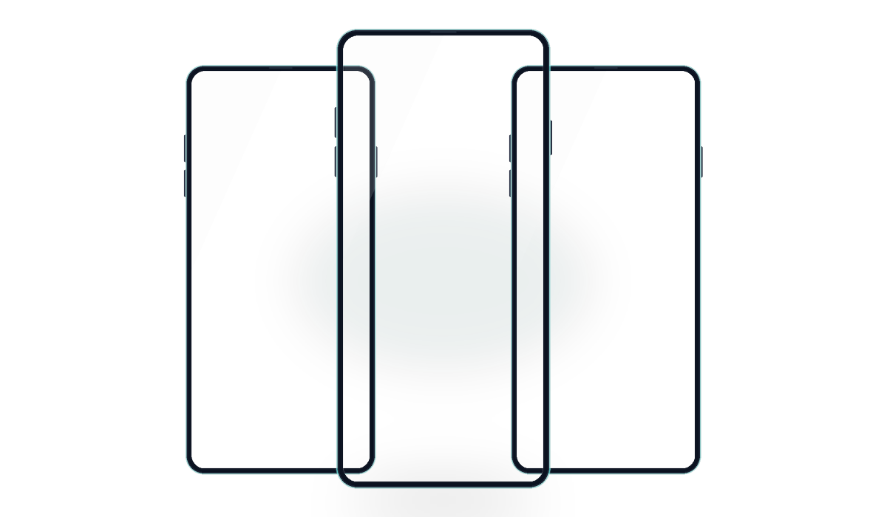

<div align="center">


# ⚡ DroidRecomp

### The Definitive Hub for Native Console & PC Recompilations & Emulators on Android

[](https://moopuu.github.io/droid-recomp/)
[-34F2E8?style=for-the-badge&logo=android&logoColor=0B1220)](https://github.com/MooPuu/droid-recomp/releases/download/v1.0.0/DroidRecomp-v1.0.0-release.apk)
[](https://moopuu.github.io/droid-recomp/)
[](LICENSE)
[](catalog.json)
[](emulators.json)
[](#-legal-compliance--byor-architecture)
[](https://moopuu.github.io/droid-recomp/)
[](https://github.com/ImranR98/Obtainium)

<p align="center">
  <b>Play Nintendo 64, PlayStation, Xbox, GameCube, Wii, Switch, and PC classics running natively on ARM64 silicon — zero emulation overhead, uncapped frame rates, and native Android touch/controller controls.</b>
</p>

<p align="center">
  
</p>

[**🌐 Launch Live Web App**](https://moopuu.github.io/droid-recomp/) • [**📲 Download APK (v1.0.0)**](https://github.com/MooPuu/droid-recomp/releases/download/v1.0.0/DroidRecomp-v1.0.0-release.apk) • [**🎮 Browse Recomps**](https://moopuu.github.io/droid-recomp/#all) • [**⚡ Emulators Hub**](https://moopuu.github.io/droid-recomp/#emulators) • [**🛠️ Submit Port**](https://moopuu.github.io/droid-recomp/#submit) • [**📥 Obtainium Pack**](https://moopuu.github.io/droid-recomp/#obtainium)

---

</div>

## 🌌 Overview

**DroidRecomp** is the definitive open-source catalog, game launcher, and native Android application designed specifically for mobile retro gaming, game recompilations, source ports, and verified emulators. While traditional emulators interpret machine instructions dynamically with heavy performance overhead, **static recompilations and decompilations** recompile original game machine code directly into native ARM64 C/C++ or compile cleanly from reverse-engineered source trees.

DroidRecomp indexes **379 verified native Android ports and static recompilations** and **curated Android emulators (Free & Paid) + Mesa Turnip GPU drivers** with step-by-step setup guides, hardware compatibility flags, dual English & Arabic localization, triple-theme switching (Midnight Slate, Cyber Frost Light, and Pure AMOLED Black), an integrated 1-tap game launcher with device app auto-detection, and deep-linking into **Obtainium** for seamless background updates.

---

## ✨ Key Features

<table>
  <tr>
    <td width="50%">
      <h3>📱 Adaptive Dual-Engine UI (Web & Flutter)</h3>
      <ul>
        <li><b>Mobile Bottom Navigation:</b> 5-tab responsive touch navigation (Discover, Browse, Emulators, Library, Guide).</li>
        <li><b>Native Flutter Android App:</b> Full native Android app with smart APK package recognition, manual app linking, and direct intent launching.</li>
        <li><b>Dual Language Support:</b> Complete English & Arabic RTL localization across both Web and Android platforms.</li>
        <li><b>Triple Theme Engine:</b> Midnight Dark Slate, Cyber-Frost Light, and Pure AMOLED OLED Black.</li>
      </ul>
    </td>
    <td width="50%">
      <h3>🎮 Library & 1-Tap Game Launcher</h3>
      <ul>
        <li><b>1-Tap Native Launching:</b> Launch any installed recomp, port, or emulator directly with a single tap.</li>
        <li><b>Smart Package Auto-Detection:</b> Scans installed packages on your phone using title & keyword matching.</li>
        <li><b>1-Tap App Linker:</b> Easily link custom community APKs directly from a live list of installed apps on your device.</li>
        <li><b>Custom Sideloaded Games:</b> Add any unlisted game or APK with package name and custom box art.</li>
      </ul>
    </td>
  </tr>
  <tr>
    <td width="50%">
      <h3>⚡ Android Emulators Hub</h3>
      <ul>
        <li>Curated console & PC emulators (NetherSX2, Sudachi, Dolphin, PPSSPP, Lime3DS, DuckStation, Vita3K, Winlator, Mobox, melonDS, Flycast, ScummVM, etc.).</li>
        <li>Direct APK download links, Obtainium deep links, and GitHub source links.</li>
        <li>Mesa Turnip Qualcomm Adreno GPU driver package companion.</li>
      </ul>
    </td>
    <td width="50%">
      <h3>🛠️ 1-Click Submission Portal</h3>
      <ul>
        <li>Interactive community submission wizard with live real-time card preview.</li>
        <li><b>1-Click GitHub Issue Generator:</b> Pre-populates a verified issue template with validated JSON.</li>
        <li>Instant clipboard export and local library testing.</li>
      </ul>
    </td>
  </tr>
</table>

---

## 🕹️ Supported Systems & Verified Highlights

Games are organized strictly by the original console or platform they were ported or recompiled from:

| Origin Platform | Architecture | Verified Playable Highlights | Input Support |
| :--- | :--- | :--- | :--- |
| **Nintendo 64** | Static Recomp & Decomp | *Zelda: Ocarina of Time* (Shipwright & Zelda64Recomp), *Majora's Mask* (2Ship2Harkinian), *Super Mario 64* (sm64ex), *Perfect Dark*, *Banjo-Kazooie*, *Doom 64 Remastered* | Touch & Gamepad |
| **PlayStation 1** | C Decomp / Native C | *Silent Hill*, *Driver 2*, *Crash Bandicoot*, *Crash Team Racing* (OpenCTR), *Ace Combat 3: Electrosphere*, *Classic Tomb Raider I & II*, *wipEout*, *Heart of Darkness* | Touch & Gamepad |
| **PlayStation 2** | OpenGOAL Source Port | *Jak and Daxter: The Precursor Legacy* (OpenGOAL Android), *Bully: Anniversary Edition*, *Dragon Ball Z: Budokai Tenkaichi 3*, *The Simpsons: Hit & Run* | Gamepad / Turnip |
| **PlayStation 3** | Native ARM64 Source Port | *God of War III Remastered* | Gamepad / Turnip |
| **Xbox 360** | ReXGlue Static Recomp | *Sonic Unleashed Recomp*, *Skate 3*, *Forza Horizon*, *GoldenEye 007 (XBLA)*, *Call of Duty: Black Ops II*, *Dante's Inferno* | Gamepad / Turnip |
| **Original Xbox** | Native Decomp | *Halo: Combat Evolved*, *Black*, *Buffy the Vampire Slayer*, *Dead or Alive: Xtreme Beach Volleyball* | Gamepad / Turnip |
| **GameCube & Wii** | Native Decomp & Engine Ports | *Super Mario Sunshine*, *Skies of Arcadia Legends*, *Super Mario Galaxy*, *Mario Kart Wii*, *The Legend of Zelda: The Wind Waker HD* | Touch & Gamepad |
| **Nintendo Switch** | Native Source Port | *The Legend of Zelda: Echoes of Wisdom*, *Pokémon: Let's Go, Eevee!*, *Diablo II: Resurrected*, *Breath of the Wild* | Touch & Gamepad |
| **Apple Arcade / iOS** | Mobile Native Port | *Rayman Mini*, *Sonic Dream Team* | Touch & Gamepad |
| **Sega Genesis & Saturn** | C Engine Ports | *Sonic 3 & Knuckles* (Sonic 3 A.I.R.), *Sonic R* | Touch & Gamepad |
| **Game Boy Family** | Native C Ports | *Pokémon Red/Blue* (Gen 1 Recomp), *Pokémon Gold/Silver* (Gen 2 Recomp), *Super Mario Land 2*, *Pokémon Emerald/FireRed* (pokeemerald), *AM2R* | Touch & Gamepad |
| **Classic PC Engines** | Clean-room Engine Ports | *Grand Theft Auto III / Vice City* (re3/reVC), *Fallout 1 & 2* (fo2exe), *Diablo 1* (DevilutionX), *The Elder Scrolls III: Morrowind* (OpenMW), *Heroes of Might and Magic II & III* (VCMI), *Return to Castle Wolfenstein* (RTCW-Touch), *Sonic Mania* (RSDKv5), *Balatro*, *Hollow Knight*, *Celeste*, *Undertale*, *Stardew Valley* | Touch, Mouse, Gamepad |

---

## 🚀 Native Flutter Android App Build Instructions

The complete native Flutter Android application source code is provided in `droid_recomp_app/`.

### Prerequisites
* Flutter SDK (3.24+)
* Android SDK & Java 17+ (JDK / Android Studio JBR)

### Compiling Release APK
Run the build script:
```powershell
powershell.exe -ExecutionPolicy Bypass -File "scripts/build_release_apk.ps1"
```
Or build manually via Flutter:
```bash
cd droid_recomp_app
flutter pub get
flutter build apk --release
```
The compiled, tree-shaken APK will be output to `build/app/outputs/flutter-apk/app-release.apk`.

---

## ⚖️ Legal Compliance & BYOR Architecture

> [!IMPORTANT]
> **DroidRecomp does NOT host, download, or distribute copyrighted ROMs, game assets, or proprietary commercial binaries.**

- **Clean-Room Engine Executables:** All indexed packages link directly to open-source developer repositories (GitHub, GitLab, Codeberg, APKVision).
- **Bring-Your-Own-ROM (BYOR):** Recompilations extract and patch assets from retail game copies purchased and legally dumped by the user.
- **Client-Side Privacy:** All local storage (favorites, custom games, installed packages, and hash calculations) operates strictly on the user's client device.

---

## 🛠️ Repository Architecture

```text
├── .github/
│   └── workflows/
│       └── pages.yml              # Automated GitHub Pages CI/CD deployment
├── docs/
│   └── assets/
│       ├── app_showcase.png       # Triple phone mock-up showcase with live app screenshots
│       └── phone_mockup.png       # Standalone phone mock-up
├── droid_recomp_app/              # Native Flutter & Android application codebase
│   ├── android/                   # Native Android wrapper, QUERY_ALL_PACKAGES & MethodChannel launcher
│   ├── assets/                    # Bundled catalog.json & emulators.json
│   ├── lib/
│   │   └── main.dart              # Flutter application code (5-tab navigation, themes, launcher)
│   ├── test/                      # Flutter widget tests
│   └── pubspec.yaml               # Flutter package configuration
├── scripts/
│   └── build_release_apk.ps1      # 1-click script to build release APK
├── index.html                     # Semantic responsive web application
├── styles.css                     # Neon cyan & dark midnight design system
├── app.js                         # Web router, launcher intent handler & submission wizard
├── catalog.js / catalog.json      # 379 verified Android recompilations & source ports
├── emulators.js / emulators.json  # Curated Android emulators & Turnip drivers
├── manifest.json                  # Progressive Web App (PWA) manifest
├── favicon.svg                    # Brand vector SVG favicon
├── DroidRecomp Logo.svg           # High-resolution vector brand logo
├── LICENSE                        # MIT License
└── README.md                      # Project documentation
```

---

<div align="center">

**DroidRecomp By Mahdi Kareem © 2026**

Crafted with ⚡ for the handheld gaming and Android emulation community by [**Mahdi Kareem (@MooPuu)**](https://github.com/MooPuu).

</div>
